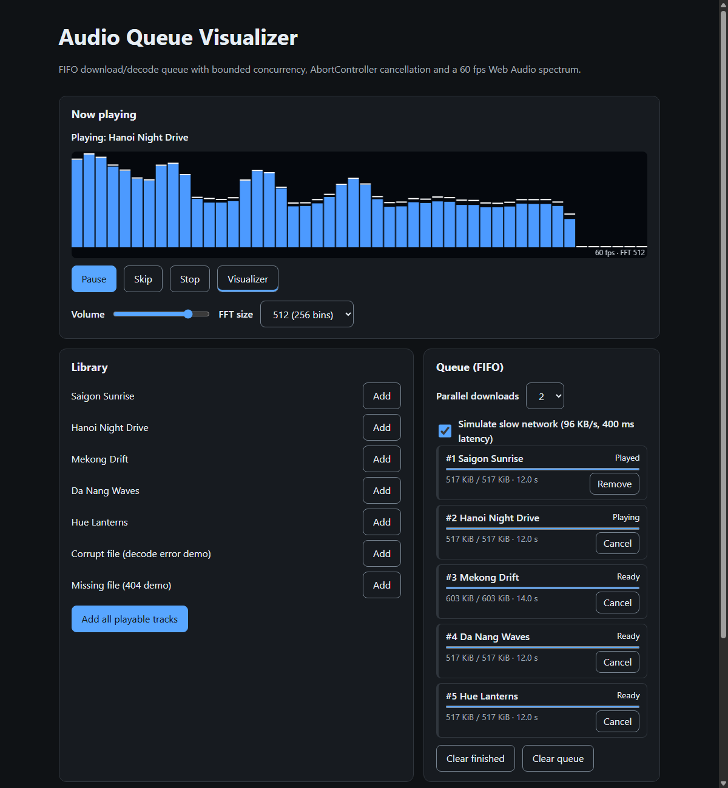
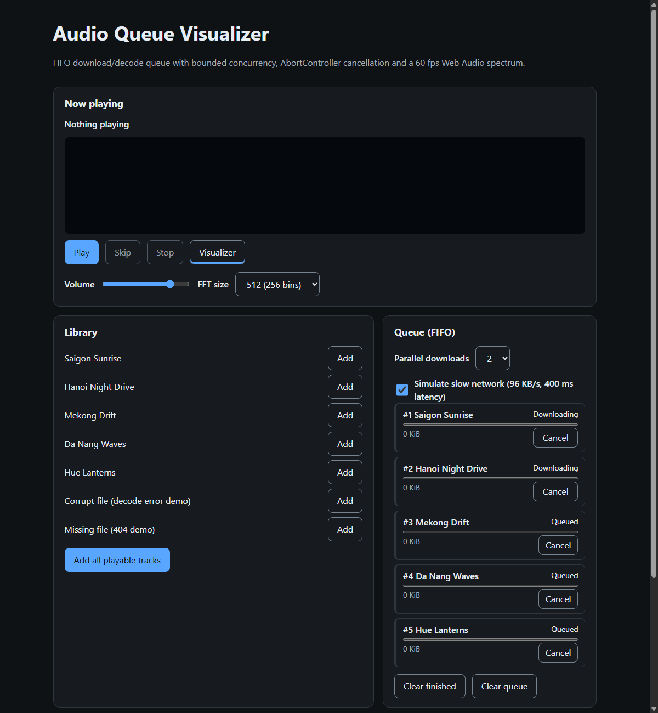

# Lab 02 · Homework 2: Concurrent FIFO Audio Visualizer Queue Engine

A Web Audio player whose tracks flow through a **FIFO, concurrency-limited download → decode queue**.
Every task can be cancelled through its own **AbortController**, audio nodes and buffers are
**explicitly cleaned up**, and a **`requestAnimationFrame` canvas visualizer** reads an `AnalyserNode`
(FFT 256 or 512) at 60 fps **without touching reactive state**. Built on the Lab 02 Mini-React engine.

| Measured in real Chrome (CDP harness, [`scripts/browser-audit.mjs`](scripts/browser-audit.mjs)) | Result |
|------|--------|
| Parallel downloads with limit 2 and a slow network | exactly 2 `DOWNLOADING`, 3 `QUEUED` |
| Visualizer frame rate during playback | **60 fps** (page rAF also 60) |
| Reactive re-renders during 3 s of steady playback | **0** |
| Analyser signal (peak byte value seen) | 255 (real audio is flowing) |
| `AudioBufferSourceNode`s created / disconnected (20 plays incl. skips) | **20 / 20**; 0 live at the end |
| Decoded buffers held after everything played | **0** |
| JS heap after forced GC, 6 full cycles | 1.21 → 1.30 MB, then flat (+0.6 KB over the last 3): no linear growth |
| Console errors / DOM-parity failures | 0 / 0 |
| Lighthouse Accessibility / Best Practices | **100 / 100** ([report](docs/lighthouse/report.html)) |
| Unit / component / checkpoint tests | **239 passing** |

Raw numbers: [docs/browser-audit.json](docs/browser-audit.json), [docs/browser-audit-heap.json](docs/browser-audit-heap.json).



- Rules: [project-rules.md](project-rules.md)
- Work breakdown: [TASK_DECOMPOSITION.md](TASK_DECOMPOSITION.md)

## Run

```bash
npm install
npm run dev        # http://localhost:5173, then press "Add all playable tracks" and Play
npm test           # 239 tests with fake fetch / fake AudioContext / manual frame scheduler
npm run typecheck
node scripts/generate-tracks.mjs   # regenerates the (byte-identical) WAV files
```

The five tracks are synthesized from scratch by [`scripts/generate-tracks.mjs`](scripts/generate-tracks.mjs)
(royalty-free, deterministic). The library also has a corrupt file and a missing file to demonstrate the
`FAILED` path. Tick **Simulate slow network** to watch the concurrency limit and progress.

## Architecture

```
            add(track)                  ┌──────────── concurrency slots (default 2) ───────────┐
Library ───────────────► FIFO queue ──► │ fetch(url, {signal}) → stream body → decode(signal) │ ──► READY
                          QUEUED        └──────────────────────────────────────────────────────┘
                                                                                                  │ take()
           ┌──────────────────────── AudioEngine ─────────────────────────┐                      ▼
           │ BufferSource ─► Gain ─► Analyser (FFT 256/512) ─► destination │ ◄──────────── PLAYING
           └──────────────────────────────┬────────────────────────────────┘   onended → complete() → PLAYED
                                          │ getByteFrequencyData (preallocated Uint8Array)
                                          ▼
                        CanvasVisualizer: requestAnimationFrame → canvas (no setState)
```

### Task state machine (`src/audio/task-state.ts`)

`QUEUED → DOWNLOADING → DECODING → READY → PLAYING → PLAYED`, plus `FAILED` (from DOWNLOADING/DECODING)
and `CANCELLED` (from any non-terminal state). Illegal transitions throw `IllegalTransitionError`.

### Concurrency controller (`src/audio/queue.ts`)

- Tasks **start in strict FIFO order**; a freed slot always goes to the oldest `QUEUED` task, even when a
  later download finishes first. Playback is FIFO too: the player waits for track 1 even if track 2 is ready.
- Bodies are read through `response.body.getReader()` for byte-level progress (`<progress>` per task).
- `enqueue(url): Promise<AudioBuffer>` (the slide contract) and `add(track) → { id, done }`. Each promise
  settles exactly once and never becomes an unhandled rejection.
- `cancel(id)` aborts that task's `AbortController` in any state, frees its slot, drops its buffer and rejects
  with `AbortError`. A decode that completes after cancel is discarded. `clear()` aborts everything *before*
  refilling slots, so no queued task is started just to be killed.

### Memory safety

| Resource | Cleanup |
|----------|---------|
| `AudioBufferSourceNode` (single-use) | on end or stop: `onended = null`, `stop()`, `disconnect()`, `buffer = null`, reference dropped (`liveSources` ≤ 1 proven over 100 plays) |
| Decoded `AudioBuffer` | dropped on `complete()` (played), `cancel()`, `remove()`, `clear()` |
| In-flight fetch / decode | `AbortController.abort()` per task |
| Throttle timers + abort listeners | `abortableSleep` clears its timer and removes its listener on every path |
| rAF loop, `ResizeObserver`, `matchMedia` listener | stopped / disconnected / removed by effect cleanups |
| `AudioContext` | created lazily inside the first Play gesture; `close()`d on unmount |

### 60 fps without state thrashing (`src/audio/visualizer.ts`)

- Audio frames never pass through `useState`. The reactive UI re-renders only on queue and engine events
  (measured: 0 commits in 3 s of playback).
- The frame loop allocates nothing. Analyser bytes go into a preallocated `Uint8Array` (reallocated only when
  `fftSize` changes; a test proves 1 allocation over 300 frames). Log-spaced bar bounds, bar heights and peak
  caps are typed arrays, and the FPS label string is rebuilt once per second.
- The canvas is sized for `devicePixelRatio` on resize only. Keyed reconciliation keeps the same `<canvas>` element
  across every re-render, so the drawing surface is never replaced.
- The visualizer can be paused (WCAG 2.2.2) and has `role="img"` with a text label.

## Bugs caught during development

| Where | Bug | Caught by | Fix |
|-------|-----|-----------|-----|
| `queue.clear()` | Cancelling tasks one by one freed slots and **started queued tasks mid-clear** (5 requests instead of 3) | unit test | abort every task first, then pump once |
| App auto-advance | `engine.play()` awaits `AudioContext.resume()` while still `IDLE`, so the effect **took a second track** | checkpoint test | `starting` guard |
| …same guard | Setting the guard *after* `queue.take()` was too late: `take()` emits, and the synchronous re-render ran the effect again inside it | checkpoint test | set the guard before `take()` |
| Engine `unmount()` (from HW1) | Cleanups emitted events and **re-rendered a half-torn-down app**, whose effects called `take()` on a dropped task | unhandled-error report in Vitest | stop rendering before cleanups (`fix(core)` commit + regression test) |

## Structure

| Path | Responsibility |
|------|----------------|
| `src/audio/types.ts` | Contracts, incl. Web Audio subsets with a compile-time proof (`type-check.ts`) that the real API satisfies them |
| `src/audio/task-state.ts` | Task FSM |
| `src/audio/queue.ts` | FIFO concurrency controller, cancellation, snapshots |
| `src/audio/throttled-fetch.ts` | Slow-network simulation (latency + byte-rate) |
| `src/audio/engine.ts` | Playback graph and node lifecycle |
| `src/audio/visualizer.ts` | Allocation-free rAF canvas spectrum |
| `src/app.ts`, `src/main.ts` | UI and real wiring (OfflineAudioContext decode, lazy AudioContext) |
| `scripts/` | Track generator and the Chrome audit harness |


